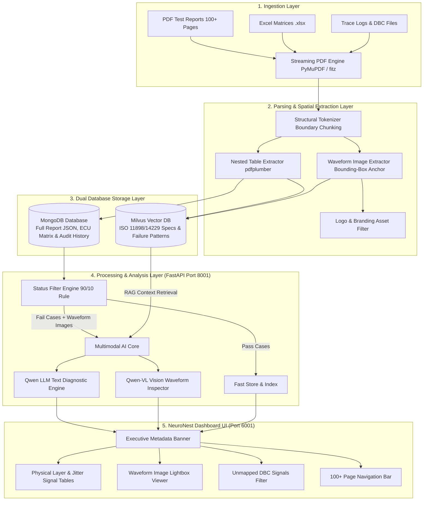

# Enterprise Architecture Overview (Updated)
## Agentic AI IVN Test Report Analyzer (NeuroNest Ecosystem)

---

## 1. System Architecture Diagram

---

## 2. Layer-by-Layer Architectural Specification

### 📥 1. Ingestion Layer
* **Automated PDF Report Reader**: Ingests multi-page and 100+ page test execution PDFs generated by Vector CANoe, vTESTstudio, and diagnostic test benches.
* **Streaming Reader (`fitz`)**: Low-memory PDF streaming engine capable of reading massive files without memory spikes.

### ⚙️ 2. Parsing & Spatial Extraction Layer
* **Structural Boundary Tokenizer**: Identifies test case delimiters (`Report: <TC_ID>` to `overallresult`) to guarantee logical chunking without severing tables across page boundaries.
* **Nested Table Extractor**: Extracts multi-column signal tables (Bit Time, Rise/Fall Time, Jitter, Periodicity, Load %).
* **Waveform Image Extractor**: Extracts embedded oscilloscope plots ($1717 \times 717\text{ px}$) and anchors them to CAN Message IDs (`C00000B`, `18F0090B`).
* **Branding Asset Filter**: Ignores static header/footer corporate logos ($168 \times 121\text{ px}$ and $443 \times 114\text{ px}$).

### 💾 3. Dual Database Storage Layer
* **MongoDB Database**: Serves as the primary persistence layer for full report JSON payloads, ECU Hardware/Software matrix (`Airbag`, `Cluster`, `EPS`), sign-off signatures (Sunil Pradhan, Diptiranjan Routaray, Sankar D), and test run history.
* **Milvus Vector Database**: Stores vector embeddings of Automotive ISO Standards (ISO 11898 CAN physical layer, ISO 14229 UDS), DBC signal matrix rules, and 100+ ECU failure modes for RAG retrieval.

### 🧠 4. Processing & Analysis Layer (FastAPI Backend - Port 8001)
* **Status Filter Engine (90/10 Rule)**: Automatically routes passed test cases directly to storage, while passing failed/inconclusive test cases to the AI Reasoning Core for 95% token savings.
* **Multimodal AI Diagnostic Core**:
  * **Text Diagnostic Engine (`Qwen3.6-27B`)**: Analyzes bit rate tolerance failures, zero bit time errors, and timing jitter deviations.
  * **Vision Waveform Inspector (`Qwen2.5-VL-72B`)**: Analyzes waveform trace images for ringing, capacitive rise time degradation ($> 190\text{ ns}$), and ground bounce.

### 📊 5. Presentation Layer (NeuroNest React UI - Port 6001)
* **Executive Header Banner**: Displays DR Stage, Project Name, ECU HW/SW matrix, and Signatures.
* **Signal Tables**: Color-coded measurement indicators (red badges for Rise Time $> 190\text{ ns}$ or Bit Time $0.00\text{ ns}$).
* **Waveform Lightbox**: Interactive modal viewer to inspect high-resolution oscilloscope plot captures.
* **Unmapped Signals Filter**: Toggle switch to isolate messages marked `Not in DBC`.
* **100+ Page Navigation Bar**: Search and filter by CAN ID, ECU name, or test case ID across large reports.
