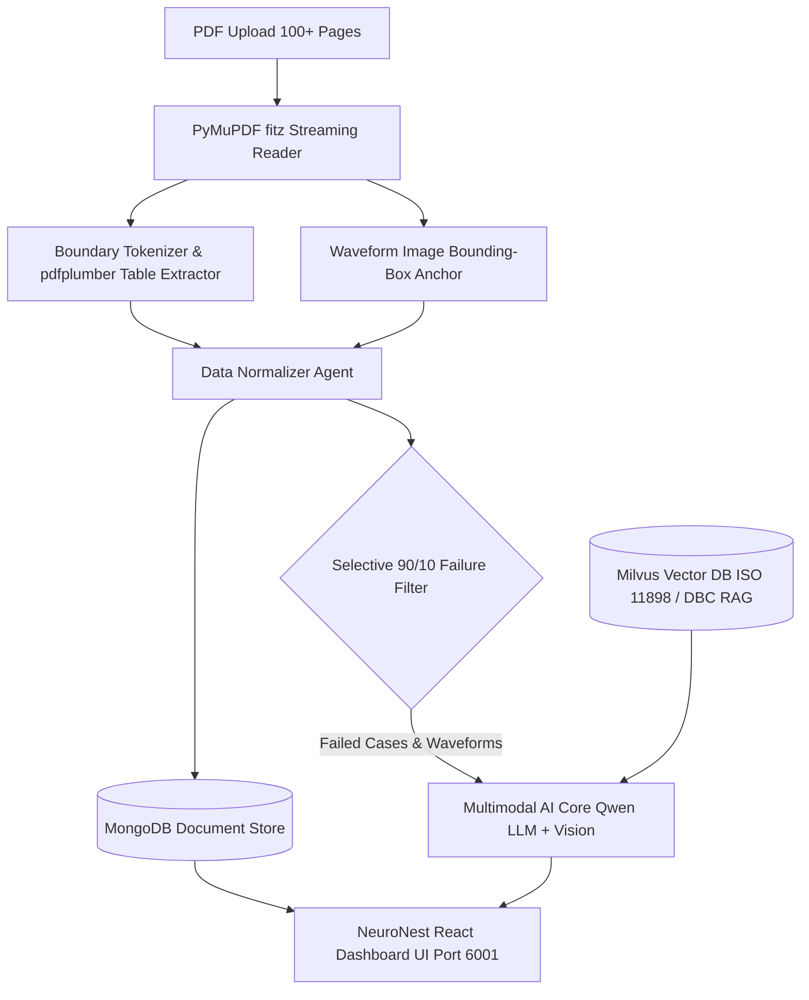

# Implementation Plan - Agentic AI IVN Test Report Analyzer

## Executive Overview
This implementation plan establishes an enterprise-grade pipeline for parsing, analyzing, and visualizing **Tata Motors & Vector CANoe IVN Test Reports** of any scale (from single-page summaries to **100+ page complete reports** containing text, multi-column tables, and embedded high-resolution oscilloscope waveform images).

---

## Architecture Diagram & Flow

---

## Phased Implementation Plan

### Phase 1: Core Parsing & Image Extraction Engine (`backend/demoapp/PDF_extraction.py`)
- [x] Analyze sample Tata Motors report structure (`IVN_Test_Report(15_57_18).pdf`).
- [ ] Implement PyMuPDF (`fitz`) streaming page reader for 100+ page files.
- [ ] Build boundary tokenizer for `Report: <TC_ID>` to `overallresult` blocks.
- [ ] Implement multi-table parser (`pdfplumber`) for:
  - Bit Time measurements (`CAN_H`, `CAN_L`, `Diff Bit_Time(ns)`).
  - Rise / Fall Time metrics (`Rise (ns)`, `Fall (ns)`).
  - Network Jitter tables (`Load %`, `Jitter %`, `minJitter`, `MaxJitter`, `Actual_Periodicity`).
- [ ] Build spatial image extractor to capture graph waveforms ($1717 \times 717\text{ px}$), anchor them to CAN IDs (`C00000B`, `18F0090B`), and filter out static header/footer logos ($168 \times 121\text{ px}$, $443 \times 114\text{ px}$).

### Phase 2: MongoDB & Milvus Database Integration
- [ ] **MongoDB Integration**:
  - Define document schema for `reports`, `ecu_hardware_matrix`, `test_cases`, and `signal_measurements`.
  - Save full structured JSON payloads for sub-second retrieval.
- [ ] **Milvus Vector DB Integration (`vector_database_creation.py`)**:
  - Ingest ISO 11898 physical layer rules (Rise Time $< 190\text{ ns}$, Fall Time $< 120\text{ ns}$).
  - Index historical ECU failure patterns and DBC signal bounds for RAG diagnostics.

### Phase 3: Multimodal AI Diagnostic Core (`backend/demoapp/app.py` & Service)
- [ ] Implement **90/10 Failure Filter**: Automatically filter passed test cases (90%) and route failed/inconclusive cases (10%) to the AI model.
- [ ] Configure `neuroverse-Qwen3.6-27B` for text diagnostics (bit time zero errors, bus-off resets, timing jitter deviations).
- [ ] Configure `neuroverse-Qwen2.5-VL-72B` Vision model for oscilloscope waveform analysis (ringing, edge deformation, high capacitance slew rates).

### Phase 4: Frontend UI Dashboard (`frontend/`)
- [ ] **Executive Header Banner**: Render Project Name (`IVN_Test_System`), DR Stage 1, ECU HW/SW matrix (`Airbag`, `Cluster`, `EPS`), and Signatures (`Sunil Pradhan`, `Diptiranjan Routaray`, `Sankar D`).
- [ ] **Signal Measurement Tables**:
  - Render color-coded status badges (Red for Rise Time $> 190\text{ ns}$ or Bit Time $0.00\text{ ns}$).
- [ ] **Waveform Lightbox Viewer**: Interactive click-to-zoom modal for high-resolution oscilloscope plot captures.
- [ ] **Unmapped Signals Toggle**: Filter frames marked `Not in DBC` (`C00000B`, `C00290B`, `C00100B`).
- [ ] **100+ Page Navigation Bar**: Search and filter test cases across large reports by CAN ID, ECU name, or test ID.

---

## Verification Plan

### Automated Verification
- Run extraction script on test report: `python backend/demoapp/PDF_extraction.py IVN_Test_Report(15_57_18).pdf`.
- Validate extracted JSON structure for metadata, test cases, embedded tables, and graph image URLs.
- Test MongoDB insertion & query performance.
- Test Milvus vector similarity search for ISO 11898 rules.

### Manual UI Verification
- Start FastAPI backend (`uvicorn app:app --port 8001`).
- Serve React dashboard (`npx serve -s build -l 6001`).
- Upload test PDF and verify:
  1. Executive Metadata & ECU matrix rendering.
  2. Interactive measurement table values matching original PDF.
  3. Waveform images opening cleanly in the Lightbox viewer.
  4. AI Root Cause Analysis summary for failed test cases (`PHL_TC006` and `PHL_TC_014`).
